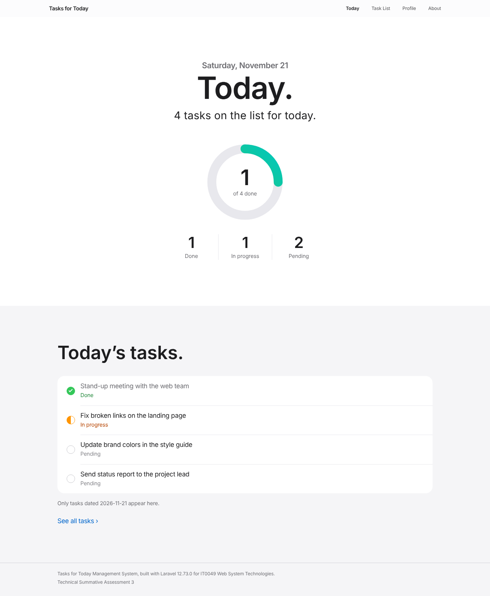
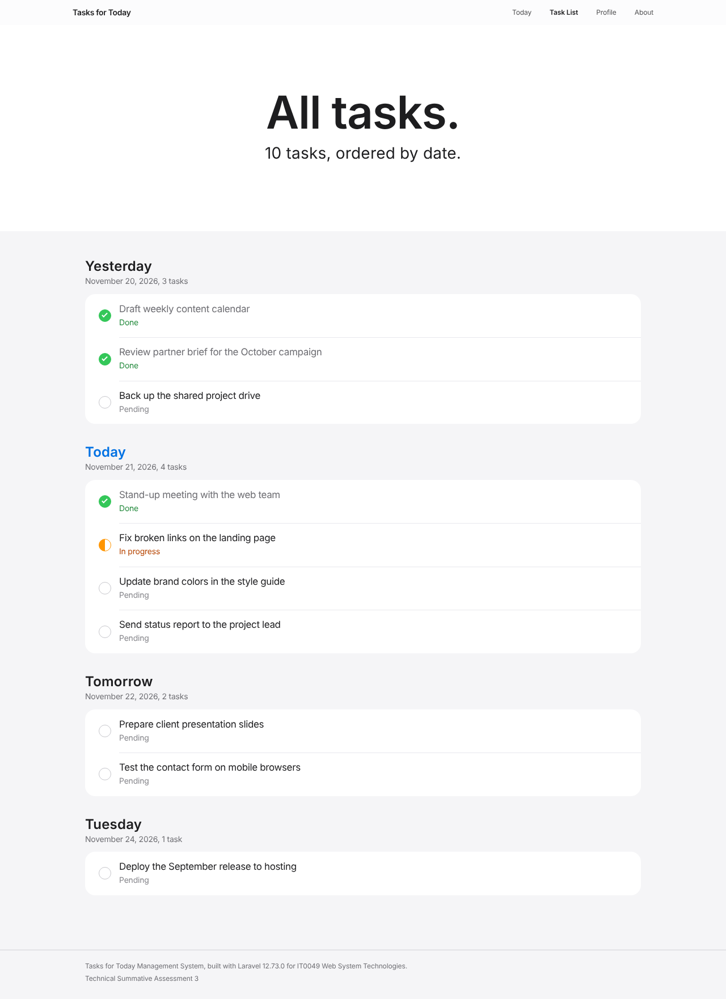
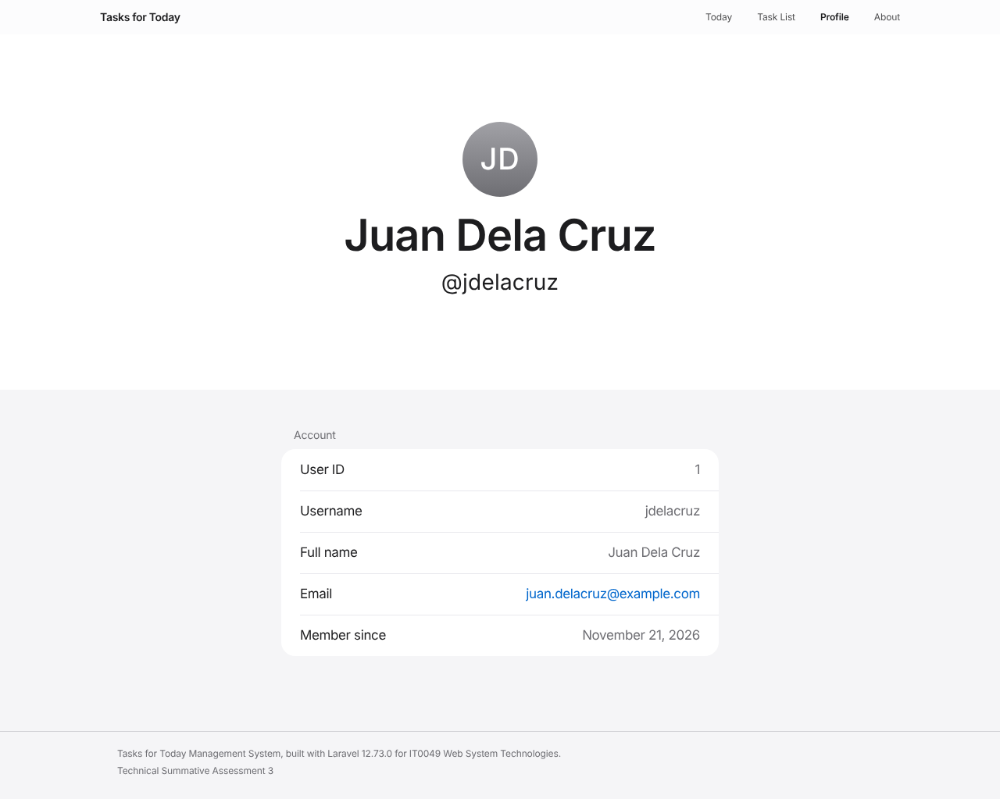
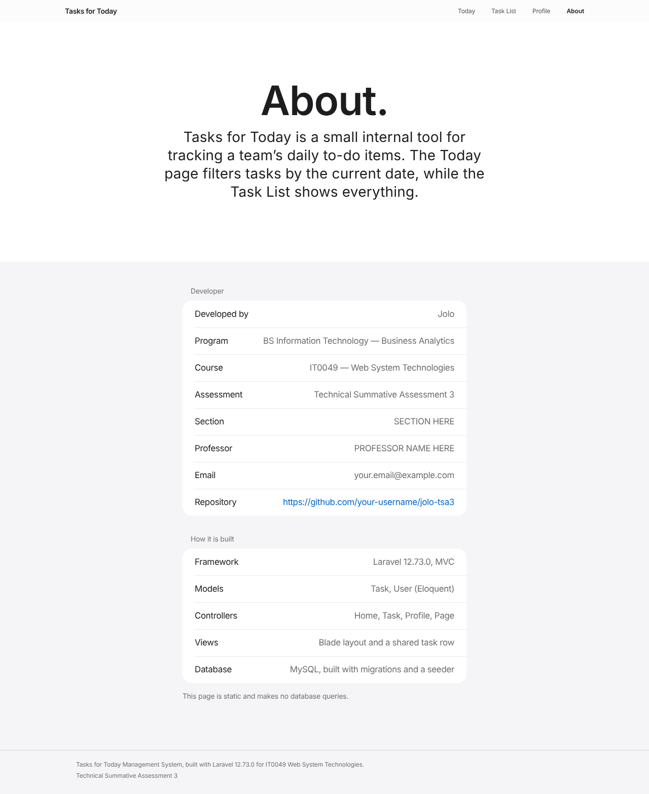
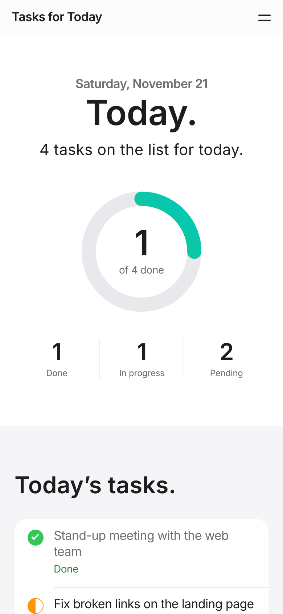
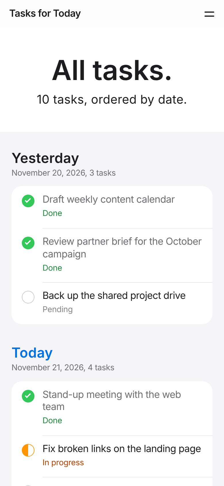
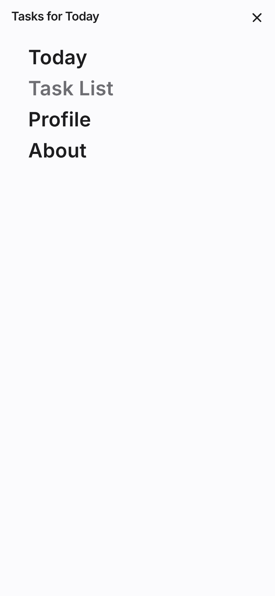
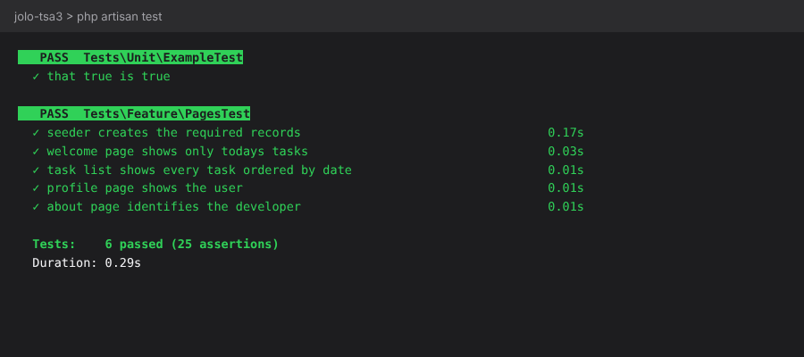

# jolo-tsa3 — Tasks for Today Management System (Laravel)

IT0049 Web System Technologies, Technical Summative Assessment 3.

The TSA1 Tasks for Today Management System rebuilt in **Laravel 12**, with migrations, a seeder
and Eloquent in place of raw SQL and the Query Builder. Same pages, same data.

**Live site:** https://jolo-tsa3n4.infinityfree.me/
**Developer:** Jolo, BS Information Technology (Business Analytics)

> The live site runs the TSA4 version of this project (repository `jolo-tsa4`), which extends
> this code with login, task management and email. Every TSA3 page and query below is unchanged there.

## Screenshots

### Welcome page: only today's tasks


### Task List: every task, ordered by date


### Profile: the single user record


### About: the developer


### On a phone
| Welcome | Task List | Menu |
|:---:|:---:|:---:|
|  |  |  |

### Tests passing


## Pages

| URL        | Route name    | Controller                 | What it shows                                    |
|------------|---------------|----------------------------|--------------------------------------------------|
| `/`        | `home`        | `HomeController@index`     | Welcome: **only** tasks where `task_date` is today |
| `/tasks`   | `tasks.index` | `TaskController@index`     | Task List: **every** task, ordered by date        |
| `/profile` | `profile`     | `ProfileController@show`   | The single user record                            |
| `/about`   | `about`       | `PageController@about`     | Static page identifying the developer             |

Both task pages read from the same `Task` model; only the query differs. The filters are
Eloquent [local query scopes](https://laravel.com/docs/12.x/eloquent#local-scopes) on the model:

```php
// app/Models/Task.php
public function scopeDueOn(Builder $query, $date): void
{
    $query->whereDate('task_date', $date);
}

public function scopeOrdered(Builder $query): void
{
    $query->orderBy('task_date')->orderBy('id');
}

// Welcome page (filtered by date)
Task::dueOn(today())->orderBy('id')->get();

// Task List page (every task)
Task::ordered()->get();
```

"Today" follows the app timezone, `Asia/Manila` (`config/app.php`).

## Database

| Migration                                   | Creates                                                         |
|---------------------------------------------|-----------------------------------------------------------------|
| `0001_01_01_000000_create_users_table`      | `users`: id, username (unique), full_name, email, timestamps    |
| `2026_11_21_000001_create_tasks_table`      | `tasks`: id, title, status (default `pending`), task_date, timestamps |

`DatabaseSeeder` runs `UserSeeder` (exactly one user) and `TaskSeeder` (10 tasks across 4 dates:
yesterday, today, tomorrow and three days ahead). The dates are relative to the day the seeder runs,
so the Welcome page always has tasks.

`database/jolo_tsa3.sql` is a phpMyAdmin export of the same tables and data, for hosting where
artisan cannot run. It uses `CURDATE()`, so today's tasks match the import date.

## Project structure

```
app/
├── Http/Controllers/   HomeController, TaskController, ProfileController, PageController
└── Models/             Task (scopes: dueOn, ordered), User
config/developer.php    developer details shown on the About page
database/
├── migrations/         users and tasks tables
├── seeders/            DatabaseSeeder, UserSeeder, TaskSeeder
├── factories/          UserFactory, TaskFactory (used by the tests)
└── jolo_tsa3.sql       phpMyAdmin export
resources/views/
├── layouts/app.blade.php
├── partials/task-row.blade.php   one task row, shared by both task pages
├── home.blade.php, tasks/index.blade.php, profile.blade.php, about.blade.php
public/assets/          css/app.css, js/app.js (plain files, no build step)
routes/web.php          the four routes
tests/Feature/PagesTest.php
docs/screenshots/        images used in this README
.htaccess               sends requests into public/ when the project folder is the web root
```

## Run locally (XAMPP on Windows)

Requires PHP 8.2+ (XAMPP's PHP works), [Composer](https://getcomposer.org) and MySQL (XAMPP's MySQL works).

1. Start **MySQL** in the XAMPP Control Panel. In phpMyAdmin, create an empty database named `jolo_tsa3`.
2. In the project folder, run:

   ```
   composer install
   copy .env.example .env
   php artisan key:generate
   php artisan migrate --seed
   php artisan serve
   ```

3. Open http://127.0.0.1:8000

The `.env.example` defaults already match XAMPP (`127.0.0.1`, user `root`, no password).
If `php` is not recognized, use the full path `C:\xampp\php\php.exe`.

To reset the data later: `php artisan migrate:fresh --seed`.

## Tests

```
php artisan test
```

`tests/Feature/PagesTest.php` checks that the seeder creates one user and at least 8 tasks over at
least 3 dates including today, that the Welcome page shows only today's tasks, that the Task List
shows every task in date order, and that the Profile and About pages load.

## Deploying to free hosting (InfinityFree)

InfinityFree's web root is the project folder (`htdocs`), not `public`. The root `.htaccess` sends
every request into `public/`, so `.env`, `vendor/`, `storage/` and `database/` cannot be opened from
a browser. Upload the project with its `vendor` folder, import `database/jolo_tsa3.sql` in phpMyAdmin,
and set the database values in `.env`.

Built with Laravel 12 so it also runs on XAMPP's PHP 8.2; the Eloquent, migration and seeder
features used are the same as in Laravel 13.
